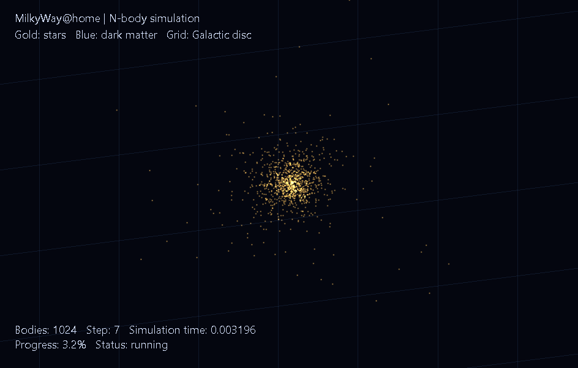
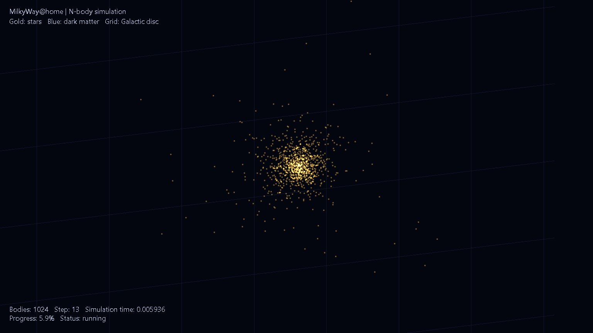

# Windows BOINC graphics launch audit (S11-01)

Audited the pinned BOINC **client 8.2.8** tree under `third_party/boinc`.
Line numbers below refer to that locally patched tree, not current upstream.
This is source inspection plus a fake-client test; installed Manager, Windows
screensaver selection and real-card operation still require the owner walkthrough.

| Contract | Pinned source evidence |
| --- | --- |
| Discovery | `client/client_state.cpp:1454-1482` links an app-version `file_ref` whose `open_name` equals `GRAPHICS_APP_FILENAME`; `lib/common_defs.h:408` defines that as `graphics_app`. `client/client_types.cpp:1121-1148` parses `main_program` and `copy_file`, **not** a `graphics_app` boolean. The package already supplies the necessary open name as well as its historical marker. |
| App-version flags and availability | `client/client_types.cpp:1095-1118` requires the graphics file's state to be `FILE_PRESENT`, then publishes its absolute project-directory path (the CPU executable check here is Apple-only). `client/app.cpp:887-898` emits `graphics_exec_path` and `slot_path` in active-task GUI data. No special `api_version`, graphics-support flag or `non_cpu_intensive` flag is needed for this separate executable path; the legacy graphics IPC path in `client/app_graphics.cpp:20-25,136-148` is deprecated. |
| Manager button | `clientgui/ViewWork.cpp:924-945` disables it with no selection, a non-throttle global suspend reason, or a remote computer. `:984-1040` switches an existing window to **Stop graphics**, rejects missing graphics/web paths, mixed graphics selections, task/project GUI suspension, and scheduler state other than `CPU_SCHED_SCHEDULED` (except stopping already-running graphics). Select one local, resumed, scheduled task. |
| Manager launch | `clientgui/MainDocument.cpp:1821-1830,1868-1871,1921-1929`: `WorkShowGraphics()` launches the absolute graphics executable with **no application arguments**, using `slot_path` as cwd. This is a local process launch, not a show-graphics RPC to science. `:1770-1772,1859-1863` stops it through `kill_process()`. |
| Windows process creation | `lib/util.cpp:215-259` quotes the executable, adds argv elements, calls `CreateProcessA` with the supplied directory, no inherited handles and flags 0. Thus the image lives in the project directory while data discovery takes place in the slot. |
| Screensaver selection and launch | `client/gui_rpc_server_ops.cpp:646-661` returns only scheduled tasks to `get_screensaver_tasks`; `clientscr/screensaver.cpp:132-164,202-215` selects graphics-capable tasks. `:272-332` launches the same path from the same slot with exactly **`--fullscreen`** on Windows. `boincscr` is the default graphics fallback (`:429-498`), not an additional argument to our helper. |
| Slot and shared-memory identity | `client/app_start.cpp:212-216` writes the slot and client PID into init data. `api/boinc_api.cpp:1051-1084` reads slot-local `init_data.xml`; `api/graphics2_util.cpp:49-65,85-96` derives `boinc_<prog_name>_<slot>` for make/attach. With our `knc_nbody` constant this is **`boinc_knc_nbody_731`** in the harness and `boinc_knc_nbody_<actual slot>` in BOINC; the client IPC segment is separate. `lib/shmem.cpp:155-175,203-224` tries `Global\` first, then the session-local name. Missing init data falls back to slot 0, so manual launches must use the actual slot cwd, not the project directory. |
| Screensaver stop/end of task | `clientscr/screensaver.cpp:388-408` looks for class **`BOINC_app`**, calls `CloseWindow` (Windows minimizes it), waits a second, then kills the graphics process, including an unconditional kill fallback. `:823-870` terminates graphics when its worker disappears/changes. `api/graphics2_win.cpp:38,303-310,347` uses the same class. Our fullscreen window handles minimization as a graceful exit; forced termination is also safe because graphics owns no science work. |
| Files staged in slot | `client/app_start.cpp:366-430` copies app-version files using their `open_name` when `copy_file` is set, otherwise creates links (`:433-445`). Our `graphics_app` slot copy is not the executable Manager launches: the absolute project image is launched. Its host DLLs must remain beside that image; the package already includes them. The consumer needs only slot `init_data.xml` and the live mapping. It does not open science input files, `knc_snapshot`, or `graphics_status.xml`; the wrapper relays snapshots into shared memory. |

## Implementation and reproducible check

`src/knc_nbody_graphics.cpp` already parses `--fullscreen`, reads slot init data,
retries mapping attachment once per second, and displays a calm waiting scene
before a valid frame. It checks equal even sequence numbers around a copy;
suspended frames remain visible and stale data become an idle scene. The
wrapper already publishes valid empty frames before the first card snapshot
and one-second heartbeats, including during suspension.

S11-01 gives the window the BOINC class and closes fullscreen on minimization.
A finished relay closes graphics after a short final-frame interval; wrapper
quit, abort, temporary exit and fatal error also publish that terminal status.
A silent producer loss eventually closes an attached consumer after 30 seconds
without a new sequence. Between five and thirty seconds the existing stale-frame
behavior remains. A helper with no mapping continues waiting, so launch-before-producer
is supported. Demo mode remains independent of task lifetime.

```bash
bash tests/wrapper.sh graphics graphics-launch
```

The `graphics` case retains the relay/suspend/resume byte checks. The
`graphics-launch` case uses a real x86 N-body app as the fake card and the actual
BOINC shared-memory implementation, launching both modes from fake slot 731.
The only extra launch option is `--screenshot`, which reads the real OpenGL
window framebuffer after live particles arrive. The test checks window styles,
fullscreen bounds, screensaver `CloseWindow` shutdown without ending science,
and automatic Manager-window exit at task completion. Test-owned graphics
processes are cleaned up even on failure.

The script saves lossless framebuffer images (client areas, without Windows
chrome) under `docs/img/`; these are live fake-card data, not demo snapshots:





The test does not launch the installed Manager or `.scr`, emulate its RPC
selection UI, exercise a service's desktop/ACLs, or contact the card. It leaves
BOINC's owner installation untouched. Follow [TRY-IT.md](TRY-IT.md#graphics-and-screensaver)
for those owner checks.
