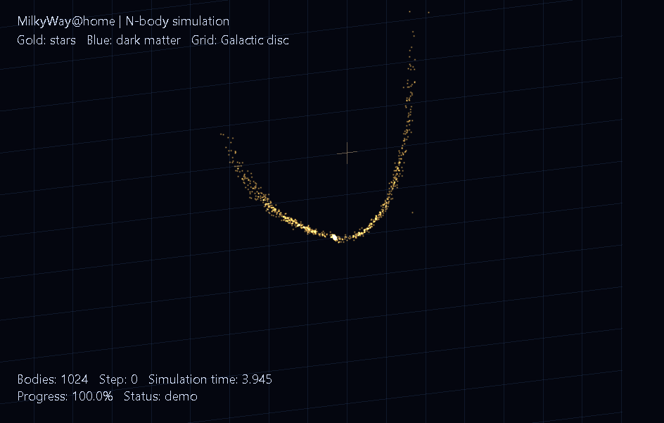

# Sprint 3 review: screensaver

Closed 2026-11-16 (EST). Goal met offline (fake card); live card feed is Sprint 4.

## Delivered
- S3-02: fixed wire format for snapshots and the graphics mapping (static asserts on x86 and K1OM);
  `knc_nbody_graphics.exe` (Win32 + legacy OpenGL, real BOINC graphics shmem, `--fullscreen`, `--demo`), packaged as
  the graphics app.
- S3-01: card app `--snapshot-interval` (up to 4096 sampled bodies, atomic rename, 0.105% cost on x86), wrapper relay
  with sequence/status (running, suspended, finished, waiting), camera framing and visual polish.

## Not proven
- Live snapshots from the real card; the BOINC screensaver launching the graphics app on the real client.

## Retro
- The first screenshot passed its checks but looked poor; looking at it was the review. Keep "the lead looks at the
  screenshot" in acceptance for anything visual.
